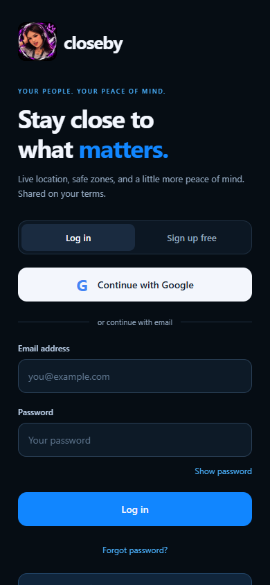
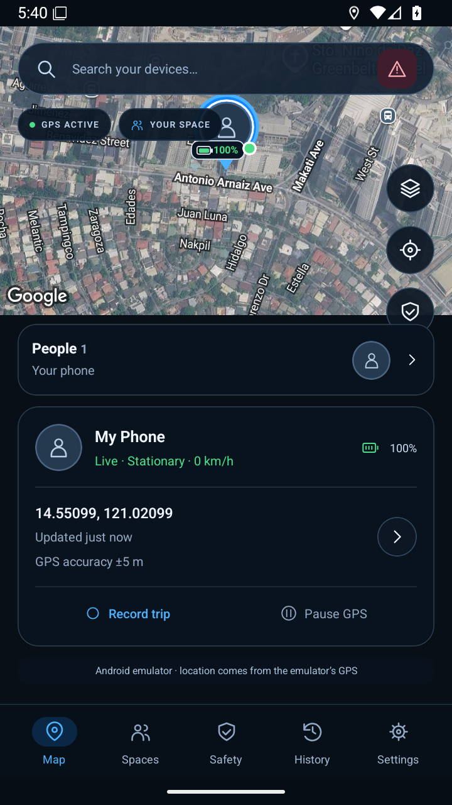
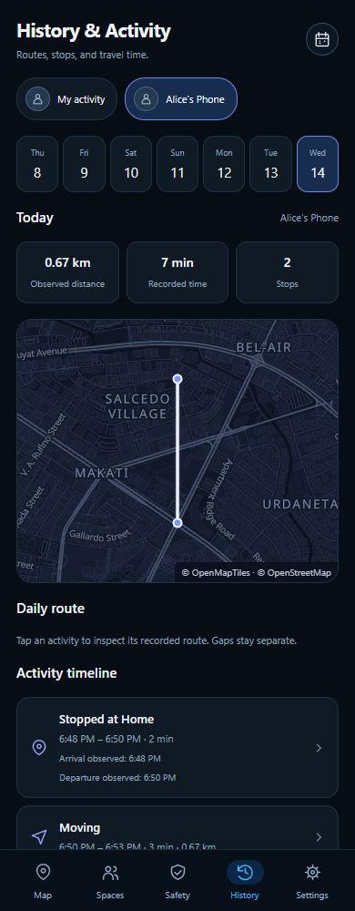
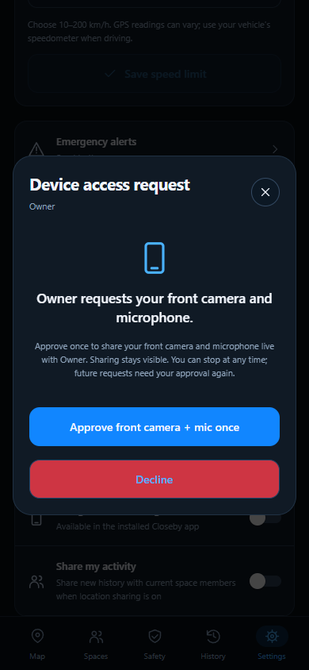

# Closeby · Phone Tracker

An Android and iOS app for finding your own phone and choosing to share its location with family or friends. Built with Expo, React Native, TypeScript, and Firebase, with a dark interface based on the supplied design reference.

**This version reads real GPS.** Foreground tracking works in Expo Go and browsers; an installed native build also supports opt-in background history. It contains no seeded people, places, or trips. You can use this device's GPS without an account. Google login, free email signup, shared locations, and shared activity history need your Firebase project and provider configuration. No cloud project or credentials are included.

**History & Activity** includes member selection, a 30-day calendar, daily routes, movement/stop timelines, observed arrivals/departures, distance, and duration. Automatic saving, background recording, and history sharing each require the person's explicit choice. See [history and background setup](docs/HISTORY_ACTIVITY.md).

**Camera & microphone requests** lets the space owner authorize selected members to request live microphone, front camera, or rear camera access. The receiving person approves every session on their device, with visible sharing status and a Stop sharing control. In the updated Android build, they can separately approve continuing that session after screen lock or swiping the app away, with a persistent notification and Stop sharing action. See [device access setup and use](docs/DEVICE_ACCESS.md).

The Android development build is verified on the emulator with native background GPS capture and Pause GPS shutdown. History, sharing consent, routes, stops, dates, and responsive layouts also pass local browser and Firebase emulator checks. See the [History preview](docs/activity-history-web.png). Physical-phone and iOS background testing remain required.

The default **Satellite + streets** map shows Google satellite imagery with roads and place labels, blue pins, and white recorded GPS trails. Google Dark, Google Street, Satellite, and Terrain are available in Map style. Satellite keeps the imagery's original colors; app controls stay dark. Required Google branding and source credits remain visible above the device card. Using the project's Android key requires an installed Closeby development build; Expo Go has its own embedded credentials. See [Google Maps setup](docs/GOOGLE_MAPS_SETUP.md). The ArcGIS renderer and saved key are retained as an alternative.

## Screenshots

Android emulator and browser captures of Closeby. Locations, routes, and account names shown here come from local tests. Click a screenshot to open it at full size.

| Sign in (browser) | Live map (Android) |
| --- | --- |
| [](docs/screenshots/sign-in.png) | [](docs/screenshots/map-android.png) |
| **History & activity (browser)** | **Device access approval (browser)** |
| [](docs/activity-history-web.png) | [](docs/screenshots/device-access-approval.png) |

## Open it on Android

For a standalone APK your family can install without a development server, follow [Build and share the Android APK](docs/APK_RELEASE.md). The local release command creates a signed file in `dist/android/` using a private key stored outside the app.

This workspace includes a portable Node runtime and a prepared Android Google APIs emulator. From the project folder in PowerShell:

```powershell
powershell -ExecutionPolicy Bypass -File .\scripts\dev.ps1 android
```

When Firebase is not configured, Closeby opens directly in local mode without signing in. Tap **Enable location** and grant permission to use this device's GPS. Local GPS, trips, and history work without a Firebase account; shared locations and chat require a configured backend. You can open account access from Settings later. The emulator receives coordinates from its location controls; these represent the virtual phone, not this computer's physical position. Use a physical phone to see that phone's actual location.

The launcher uses `.tools/android-avd-google/Closeby_Phone_Google_API_36` when available and falls back to the basic Android image. It sets the local SDK, emulator, Node, and cache paths for its own process without changing global settings.

To start Expo for a physical Android phone or iPhone:

```powershell
powershell -ExecutionPolicy Bypass -File .\scripts\dev.ps1
```

Install **Expo Go**, connect the phone and computer to the same Wi-Fi network, and scan the terminal's QR code. Foreground GPS, maps, and configured Firebase email authentication work in Expo Go. Native Google sign-in requires a development build; see [Firebase and Google setup](docs/FIREBASE_SETUP.md). An iOS simulator requires macOS; a physical iPhone can connect to the Expo server on Windows.

For an optional browser preview:

```powershell
powershell -ExecutionPolicy Bypass -File .\scripts\dev.ps1 web
```

The browser uses its own location permission and reported coordinates. Availability and accuracy depend on the browser and device.

## What works

Profile pins include measured battery percentages and a selected-person arrival/stay bubble. Saved places have names and optional descriptions. Opt-in phone notifications can monitor arrivals and departures for this phone and sharing family members while Closeby is in the background. See [arrival alerts and phone setup](docs/ARRIVAL_ALERTS.md).

| Screen | Behavior |
| --- | --- |
| Map | Real street or satellite map, measured phone position, GPS status, device selection, recentering, and trip recording. |
| Spaces | Create or join a private space, invite members, view member locations on the map, control your sharing, and send live group messages. Members appear immediately after accepting, even with sharing paused. |
| History | Automatic daily GPS routes, member selection, calendar, movement/stop timeline, observed arrivals/departures, distance, duration, and private manual trips. Empty dates stay empty. |
| Safety | Live measured speed in km/h, accumulated trip kilometres, speed warnings, and private or space-wide emergency alerts. |
| Settings | Per-account speed limit and warning controls, location sharing, arrival notifications, optional background monitoring, map style, permissions, account access, and history deletion. |
| Geofence | Pin and name safe places on the map, add descriptions, optionally adjust the arrival distance, and receive arrival/departure alerts. |
| Device profile | Measured location, update time, battery, GPS accuracy, speed, emergency alerts, and an optional phone share-sheet action. |

Battery, speed, and accuracy come from device APIs. Unavailable readings are shown as unknown. The app does not invent addresses, cellular signal strength, or travel routes.

See the [screenshot gallery](#screenshots) above. Additional captures: [Spaces on Android](docs/live-spaces-android.png), [Safety on Android](docs/live-safety-android.png), [Safety on web](docs/live-safety-web.png), [Spaces on web](docs/live-spaces-web.png), and the [activity calendar](docs/activity-calendar-android.png).

## Speed warnings and emergency alerts

Open **Safety** for the phone's measured GPS speed in **km/h** and current trip distance in **km**. Start **Record a trip** to accumulate distance; stopping saves it to History. Distance totals retain all accepted segments even when the displayed route is reduced. Missing or stale speed readings show as unavailable.

In **Settings ? Speed & safety**, enable **Speed alerts** and choose a whole-number limit from **10 to 200 km/h**. The default is **80 km/h**, with alerts initially off. Preferences stay on this device separately for each account and local mode. Warnings check this phone while GPS runs, plus members who actively share fresh speed in the space. A warning requires two accurate readings at least three seconds apart; readings above 50m GPS uncertainty are excluded, and confirmation, hysteresis, and cooldown prevent repeated warnings from the same overspeed episode. No automatic coordinate sharing is enabled by a speed warning.

Use **Send emergency alert** in Safety, the map search bar, a device profile, or the space header. Choose **Space owner** for a private alert visible only to the sender and owner, or **Everyone** for all current members. If you own the space, choose Everyone. Add an optional message and explicitly include the phone's GPS position if available; this can include coordinates while ordinary sharing is paused. With GPS off, send without a position. An alert is reported as sent only after Firebase accepts it, and retrying the same send avoids duplicate records.

Recipients hear a repeating ring, feel a vibration on native phones, and see an in-app emergency banner while Closeby is open. Opening or dismissing the banner stops the ring and records a local read marker; the ring also stops after 30 seconds or when the app leaves the foreground. The latest 100 visible alerts remain in Safety. This version has **no background push delivery** and does not contact emergency services. Recipients can check stored alerts when they reopen the app. Real shared alerts require Firebase configuration plus the supplied rules **and indexes**. Install the updated APK for the audio module and bundled ring; see [emergency alert sound](docs/EMERGENCY_ALERTS.md).

## Spaces, invitations, and messages

Open **Spaces** to create a named space or accept a shared invitation code. The **Members** tab lists everyone who has joined; enable **Share my location** to publish your GPS to the space. Updates continue in the background when native background recording is enabled. Tap a member's map button to view their shared position. The **Messages** tab supports live group chat, sender names, timestamps, and visible sending status. Messages are limited to 2,000 characters and the screen displays the latest 100. Chat works with location sharing paused.

Use the plus button to share an invitation, renew it as the owner, or leave. Renewal revokes the old code without removing members. One current space per account is supported, using the existing circle data. Group messages are stored in Firestore and are accessible to current space members; leaving removes your access but keeps past messages in the space. There are no background message notifications in this version.

## Activate accounts and family sharing

Follow **[docs/FIREBASE_SETUP.md](docs/FIREBASE_SETUP.md)** to create or reuse a Firebase project, enable Email/Password authentication, create Firestore, fill in the existing `.env`, and deploy access rules and indexes with the free Spark configuration. Preserve existing ArcGIS settings. The guide also covers optional Google authentication, Android signing fingerprints, iOS OAuth configuration, and development builds. This workspace's configured development connection is documented in **[FIREBASE_CONNECTION.md](docs/FIREBASE_CONNECTION.md)**.

Signup has no app subscription charge. Firebase's Spark plan can support initial development within its quotas; Firebase, Expo build services, and other providers have their own limits and terms. Google and email authentication cannot succeed until your provider configuration is supplied.

Each person signs in with their own account, accepts a circle invitation code, grants location permission, and turns on sharing. A phone number alone cannot reveal someone's location. Rules restrict shared locations to the same circle, and each account can write only its own device record. Sharing is off by default. Pausing clears the remote coordinate when Firebase receives the update; sign-out waits for confirmation that the shared location was cleared. An offline phone cannot immediately remove information already received elsewhere.

`app.config.ts`, `eas.json`, and `expo-dev-client` prepare the native development-build path. Google OAuth cannot run inside Expo Go. Cloud login, email delivery, Google OAuth, native development builds, and sharing between two physical phones still need verification with your project and signing credentials.

## Location, maps, and limits

- **Foreground and optional background:** GPS starts only after you enable it and grant permission. Foreground mode pauses when the app leaves the foreground. An installed native build can continue automatic history and opted-in sharing after Background recording and background access are enabled. Pause GPS or sign out to stop. Force quit and operating-system restrictions can stop delivery. Expo Go and browsers remain foreground-only.
- **History:** Manual trips and safe zones stay on this device, separately for each account/local mode. Up to 12 manual trips retain up to 600 display points while preserving accumulated distance. Automatic activity retains up to 30 days and 3,000 samples per day. Shared activity contains only new captured points after explicit consent; private old trips are not uploaded. Current-member access, stop inference, storage limits, and TTL retention are described in [HISTORY_ACTIVITY.md](docs/HISTORY_ACTIVITY.md).
- **Safe zones:** Up to 20 named places stay on this device. Active GPS enables styled arrival/departure banners. The updated native build supports optional background phone notifications for this phone and sharing family members; enable them in Settings and grant background location access. See [arrival alerts](docs/ARRIVAL_ALERTS.md).
- **Circles:** One current circle and one current device record per account. Signing in on another phone with the same account replaces that account's device record. Shared updates are throttled to about once every ten seconds. Stale locations show their age.
- **Emergency alerts:** Explicitly send to the space owner or everyone in your space, with optional coordinates. Firebase confirmation does not mean a recipient has opened or read the alert. Alerts appear in the app and remain in its history; background push delivery is not implemented. The separate **Share this location** action opens the phone share sheet.
- **Network maps:** Midnight uses MapLibre with OpenFreeMap vector tiles and visible OpenMapTiles/OpenStreetMap attribution. It requires no map key. Optional Google street, satellite, hybrid, terrain, and traffic views need the platform configuration described in [Google map setup](docs/GOOGLE_MAPS_SETUP.md) and retain Google's logo and copyright. Requested map areas are visible to the chosen provider. Network access and provider availability are required; no offline prefetching is implemented.
- **Accuracy and connectivity:** GPS can be unavailable, imprecise, or stale. Maps and shared locations need a network connection. The app is not a guaranteed emergency or safety service.

## Fresh Windows setup

Install Node.js compatible with this project's dependencies, or download a verified portable runtime using Python 3.11 or later:

```powershell
python scripts/bootstrap-node.py
```

To prepare the local Android SDK and basic emulator, then add the Google APIs image used in this workspace:

```powershell
python scripts/bootstrap-android.py all
python scripts/bootstrap-android.py google
powershell -ExecutionPolicy Bypass -File .\scripts\dev.ps1 android
```

The basic setup downloads approximately 1.3 GB; the Google APIs image adds approximately 1.9 GB. Downloads come from Google's official repositories and archive checksums are verified. Hardware virtualization and Windows Hypervisor Platform must be enabled. SDK files, virtual devices, portable tools, and caches stay under the project and are ignored by Git. The launcher installs npm dependencies if they are absent.

## Development and verification

```powershell
powershell -ExecutionPolicy Bypass -File .\scripts\dev.ps1 typecheck
powershell -ExecutionPolicy Bypass -File .\scripts\dev.ps1 check
```

Main implementation files:

- `src/ClosebyApp.tsx` and `src/screens/`: account/local-mode entry, navigation, and native screens.
- `src/hooks/useTracking.ts`: permission handling, foreground GPS, local routes, and safe zones.
- `src/lib/activity.ts`, `src/hooks/useActivityHistory.ts`, and `src/services/activity*`: automatic history, stop inference, consent, shared day queries, and local persistence.
- `src/services/backgroundTracking.ts`: top-level native background task and pause/account checks.
- `src/lib/openMapHtml.ts`, `src/lib/openMap.ts`, `src/components/OpenTrackingMap*`, and `src/components/LiveMap*`: custom vector maps, validated map messages, and optional Google views.
- `src/auth/`, `src/services/circles.ts`, and `src/hooks/useCircle.ts`: authentication and shared-device lifecycle.
- `firestore.rules` and `firestore.indexes.json`: private space access, self-only device writes, and recipient-scoped emergency alert queries.
- `src/lib/speedAlerts.ts`, `src/hooks/useSpeed*`, and `src/services/emergencies.ts`: speed preferences, confirmed warnings, and emergency delivery.
- `src/theme.ts` and `src/components/Ui.tsx`: colors and shared controls.

TypeScript, dependency compatibility, and platform JavaScript bundling have been checked. All 28 Firebase emulator/service tests passed, including emergency recipient privacy, duplicate retries, offline sends, membership, private messages, and location consent. All 22 speed/preference/distance tests and 10 Firebase initialization tests passed; three-account browser tests also passed for emergency delivery, GPS speed warnings, optional coordinates, trip distance, and 320?430px layouts. Android layout and navigation checks passed for Auth, Map, Spaces onboarding, History, and Settings at 320, 360, and 411dp. Browser checks passed at 320, 360, 390, 430, and 768px with no horizontal overflow. Short screens use a horizontal row of map controls so the device card does not cover them. Signed-in member/chat layouts still need native testing after Firebase is connected. Emulator-supplied GPS does not establish physical-device accuracy, and physical Android/iOS behavior needs device testing. Instructions for reproducing the local Firebase checks are in the [setup guide](docs/FIREBASE_SETUP.md).

The current dependency audit reports **27 advisories: 20 high and 7 moderate**. Findings include inherited Expo/React Native build-tool dependencies and Firebase's transitive Node gRPC server dependency; those gRPC server paths are not used by the React Native Firestore client. This does not establish that every dependency is risk-free. Review compatible upstream fixes before production. Forced downgrades to old Expo, React Native, or Firebase versions have not been applied.
